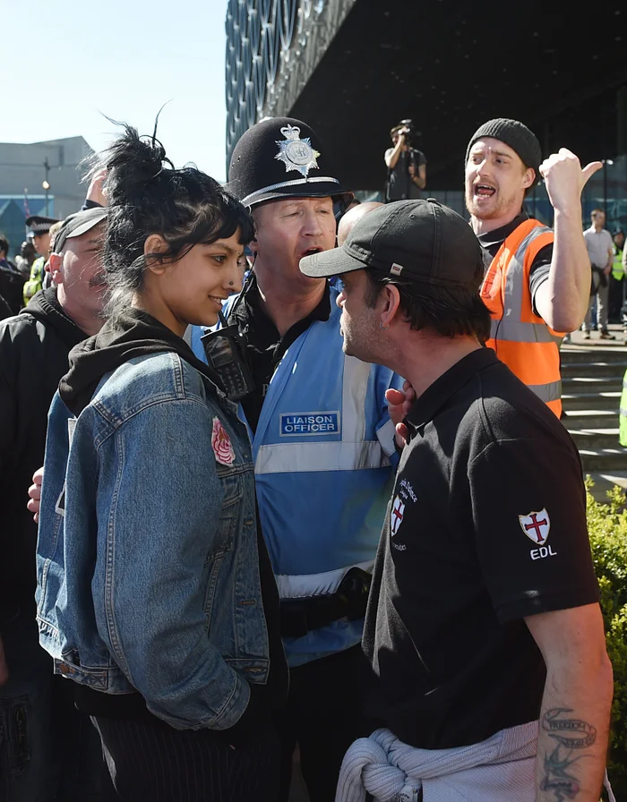

#### The Self

For most, style choices are part of the few ways they express themselves artistically. As a person who has to exist in many different contexts (politically, professionally, religiously), it can feel a bit overwhelming to think about, "what should I wear today?"

I used to frequently visit Capitol Hill and talk to Congressional staffers and I felt deeply conflicted. Particularly, when I was a younger person, I hated the idea of wearing a suit and tie and what that clothes _represented_. But, I don't actually think this is a case where you like, abandon your ideals as you get older or have to make compromises to exist under capitalism. What I think really emerged in me is that I began to strongly believe in *ideas* like direct democracy (but not in the sense of Rousseaian republicanism.) So I began to see the clothes I wore as an extension of my own beliefs and not as a way of fitting in to expected mode of respectibility. 

I really like what Derek Guy wrote about [clothing as a poor way](https://archive.ph/GNDaW) for understanding people's true views. Often, we treat thinks like formal (dress) clothes as a sign of authority or trustworthyness (often its actually the opposite). 

> Clothing is a poor proxy for a person’s more important inner qualities, such as character, capability and intelligence. Respectability can be more directly measured by a person’s actions. The reason the Senate should maintain the dress code is precisely because clothing is not all that important — next to debates over who gets welfare and who goes to war, fashion is simply not a serious concern. The dress code is about something deeper than that. The point of wearing a suit to Congress is to give physical form to the genuine ideals in your heart: your dedication to upholding your oath of office, your devotion to the institution of democracy, your unshakable commitment to the constituents you serve. If you don’t demonstrate these ideals through your behavior, a suit won’t make up for it. By focusing too much on the mere appearance of respectability, Fetterman’s critics lose sight of the deeper, more meaningful aspects of what it means to serve honorably."

Anthropologically, I know we all view our sense of self most distinctly in our dress choices and it feels like I am changing who I am in order to conform to an audience. In some ways that is true but for me, wearing a black hoodie doesn't make you hacker nor does having torn up clothes make you a punk. 

I love this photo of Suffyiah Khan standing up in a street confontration to the EDL, a noxious group of racists. What makes Suffyiah Khan a punk in the photo? 

The denim jacket is, of course, a staple of the working class. But being working class does not necessarily make a person antifascist? Is punk related to a specific _look_? I've meet plenty of self-described punks who are very apolitical. And of course, we know about the (non)inclusion of women, queer, and Brown people in [the punk and ska scene](https://www.youtube.com/watch?v=5aIf5_U5OG4) (as reflected by the Specials shirt). So clearly, there's more than external appearances. Besides, we carry a new world in our hearts.
